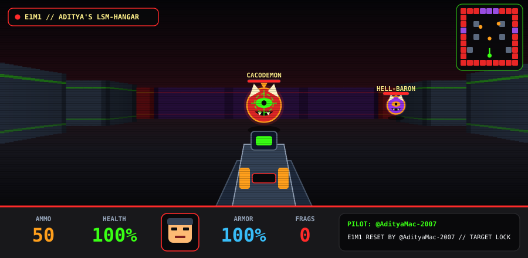

## E1M1 // ADITYA'S LSM-HANGAR — PLAYABLE 3D DOOM

 

### PLAY DOOM RIGHT HERE — CLICK ANY CONTROL
Click a move, hit <b>Create</b> on the pre-filled issue, wait ~10s for the 3D raycaster to render, then refresh!

  

<a href="https://github.com/AdityaMac-2007/AdityaMac-2007/issues/new?title=DOOM:left"><kbd>&nbsp; ⬅️ TURN LEFT &nbsp;</kbd></a>
&nbsp;
<a href="https://github.com/AdityaMac-2007/AdityaMac-2007/issues/new?title=DOOM:forward"><kbd>&nbsp; ⬆️ FORWARD &nbsp;</kbd></a>
&nbsp;
<a href="https://github.com/AdityaMac-2007/AdityaMac-2007/issues/new?title=DOOM:fire"><kbd>&nbsp; 🔥 FIRE PLASMA &nbsp;</kbd></a>
&nbsp;
<a href="https://github.com/AdityaMac-2007/AdityaMac-2007/issues/new?title=DOOM:right"><kbd>&nbsp; ➡️ TURN RIGHT &nbsp;</kbd></a>
&nbsp;
<a href="https://github.com/AdityaMac-2007/AdityaMac-2007/issues/new?title=DOOM:back"><kbd>&nbsp; ⬇️ BACK &nbsp;</kbd></a>
&nbsp;
<a href="https://github.com/AdityaMac-2007/AdityaMac-2007/issues/new?title=DOOM:reset"><kbd>&nbsp; 🔄 NEW RUN &nbsp;</kbd></a>

---

### WEAPON LOADOUT (CLICK TO INSPECT BUILDS)

<code>[SLOT 1]</code> <b>lsm-engine</b> — Zero-Dependency Rust LSM-Tree DB + Time-Series Crypto Cockpit

 

- **Engine:** Custom WAL (IEEE CRC32 + crash recovery), MemTable, 4KB SSTables, Bloom Filters, K-way Compaction, and MVCC snapshot isolation in pure Rust.
- **Live App:** Time-Series Engine streaming live BTC/ETH/SOL ticks into a Material 3 Expressive + Spring-Physics cockpit.
- **Repo:** [AdityaMac-2007/lsm-engine](https://github.com/AdityaMac-2007/lsm-engine)

<code>[SLOT 2]</code> <b>serverless_coldstart_benchmark</b> — Cloud Tail-Latency Profiler (Python)

 

- Measures and analyzes serverless cold-start latency distributions.
- **Repo:** [AdityaMac-2007/serverless_coldstart_benchmark](https://github.com/AdityaMac-2007/serverless_coldstart_benchmark)

<code>[SLOT 3]</code> <b>Hospital_management-DBMS</b> — Relational Hospital Backend (Python & SQL)

 

- Relational DBMS backend covering patients, doctors, and billing transactions.
- **Repo:** [AdityaMac-2007/Hospital_management-DBMS](https://github.com/AdityaMac-2007/Hospital_management-DBMS)

<code>[SLOT 4]</code> <b>pokemon-island-royale</b> — Battle Royale Simulation Engine (Python)

 

- Turn-based battle royale game loop and state-machine simulation.
- **Repo:** [AdityaMac-2007/pokemon-island-royale](https://github.com/AdityaMac-2007/pokemon-island-royale)

